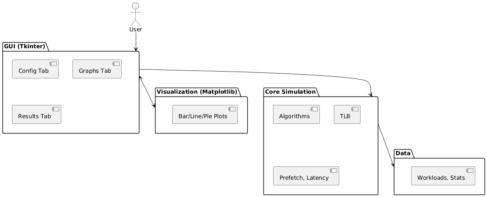
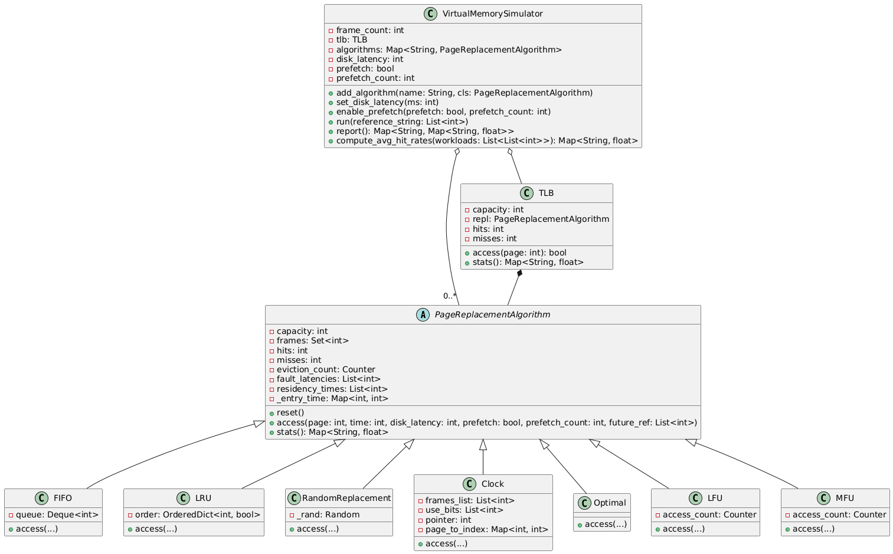

# Virtual Memory & Page Replacement Simulator (v1.0)

> **Note:** This folder contains **v1.0** (Legacy version) of the project featuring the original Tkinter desktop GUI. For the modern, re-architected version with CLI, web visualizer, and extended test suite, see **[`vmsim_v2`](../vmsim_v2)**.

A comprehensive simulation tool for understanding Virtual Memory management and Page Replacement Algorithms. It provides an interactive GUI with real-time plotting, step-by-step tracing, and detailed performance analytics.

## 👥 Authors
| ID | Name |
|---|---|
| 23K-2084 | Ayaan Irfan |
| 23K-2082 | Muneeb Ahmed |
| 23K-2064 | Faizan Ashfaq |

---

## 🚀 Features

- **8 Page Replacement Algorithms** running side-by-side for instant comparison.
- **TLB Simulation** — configurable size and replacement policy (FIFO, LRU, Random, etc.).
- **Step-by-Step Trace Tab** — visualises every frame state, marking page faults (★) and hits (·) with colour-coded rows.
- **4 Embedded Performance Charts**:
  - **Average Hit Rate**: Compare efficiency across multiple synthetic workloads.
  - **Hit Rate Trend**: Visualise performance stability across workloads.
  - **Page Fault Count**: Total faults on the active reference string.
  - **Residency Time**: Average time a page stays in physical memory.
- **3 Visualization Styles** — Toggle between Bar, Line, and Pie charts for the hit-rate overview.
- **Hardware Simulation** — Configure Disk Latency (ms) and Prefetching strategies.
- **Deep Analytics** — Hit rate, page-fault rate, average fault latency, residency mean/standard deviation, and a full eviction map.

---

## 🏗 Architecture

The project follows a modular design where the simulation engine is decoupled from the visualization layer, allowing it to be used as both a standalone application and a library.


*Figure 1: High-level architectural overview.*


*Figure 2: Detailed class hierarchy and simulation logic.*

### Logic Overview
```
page_replacement_simulator.py
│
├── PageReplacementAlgorithm  (ABC)
│   ├── FIFO / LRU / Optimal
│   ├── Clock  ──► SecondChance (alias)
│   ├── RandomReplacement
│   └── LFU / MFU
│
├── TLB                         (Wraps any algorithm)
│
├── VirtualMemorySimulator      (Simulation Engine)
│   ├── run(reference_string)
│   ├── run_trace(ref, algo)    ← Powers the Trace tab
│   ├── report()
│   └── compute_avg_hit_rates()
│
└── PageReplacementUI           (Tkinter GUI)
```

---

## 🧠 Algorithms Implemented

| Algorithm | Strategy |
|---|---|
| **FIFO** | Evict the oldest-loaded page. |
| **LRU** | Evict the page that hasn't been used for the longest time. |
| **Optimal** | Belady's Algorithm: Evict the page used farthest in the future. |
| **Clock** | Approximates LRU using a "second chance" reference bit. |
| **Random** | Evict a page selected uniformly at random. |
| **LFU** | Evict the page with the lowest access frequency. |
| **MFU** | Evict the page with the highest access frequency. |

---

## 🛠 Installation & Usage

### Requirements
- **Python 3.10+**
- **Matplotlib** (for charts)
- **Tkinter** (usually included with Python)

```bash
pip install matplotlib
```

### Launching the Simulator
```bash
python page_replacement_simulator.py
```

### Using as a Library
The simulation engine can be integrated into other Python projects:

```python
from page_replacement_simulator import VirtualMemorySimulator, LRU, FIFO

# Setup simulator with 4 physical frames
sim = VirtualMemorySimulator(frame_count=4)
sim.add_algorithm('FIFO', FIFO)
sim.add_algorithm('LRU',  LRU)

# Run a reference sequence
ref = [7, 0, 1, 2, 0, 3, 0, 4, 2, 3]
sim.run(ref)

# Get detailed statistics
print(sim.report())
```

---

## 📂 Project Structure

```
vmsim_v1/
├── Diagrams/
│   ├── architecture_diagram.png    ← System overview
│   └── class_diagram.png           ← Logic structure
├── page_replacement_simulator.py   ← Main Tkinter application & engine
├── page_replacement_simulator1.py  ← Earlier v1 revision / draft
├── README.md                       ← This documentation
└── Project Report.docx             ← Comprehensive academic report
```

