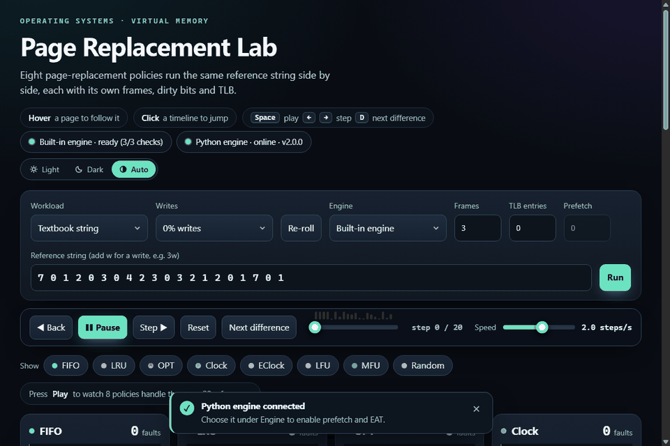

# vmsim v2 — Virtual Memory & Page Replacement Simulator

Authors: 23K-2084 Ayaan Irfan · 23K-2082 Muneeb Ahmed · 23K-2064 Faizan Ashfaq

A rebuilt version of the Operating Systems project: a **pure-Python engine** (standard library only), a **CLI**,
a **195-test suite**, a small **local HTTP engine**, and a **single-file HTML visualizer** that steps through
eight replacement policies side by side.

## Quick start

```bash
python -m vmsim run --frames 3 --steps LRU        # textbook string, 8 policies, step table for LRU
python -m vmsim belady                            # faults vs frames, detects Belady's anomaly
python -m vmsim workloads --frames 8              # policy x workload hit-rate matrix
python -m vmsim run --workload zipf --writes 0.3 --tlb 8 --prefetch 2 --json out.json --csv out.csv
python -m vmsim report --out RESULTS.md           # Markdown tables generated from real runs
python -m vmsim serve                             # local engine for the visualizer (127.0.0.1:8765)
```

Requires **Python 3.9+** (developed and tested on 3.12; static analysis shows nothing newer than 3.8 is used).
No dependencies. Optional: `pip install -e ".[dev]"` adds a `vmsim` command and pytest.

```bash
python -m pytest -q                               # 195 tests, about 9 seconds
```

## The visualizer



Open `visualizer.html` in a browser. It works on its own with a built-in JavaScript engine. For best results
**download the file and open it from disk** rather than inside a chat or preview pane, which may block it from
reaching the local Python engine (browsers restrict pages from talking to `127.0.0.1`).

- **Status pills** at the top show both engines. *Built-in* runs a self-test on load (textbook string: FIFO 15,
  LRU 12, OPT 9). *Python* shows online or offline, re-checked every 4 seconds while the tab is visible.
- **Python engine:** run `python -m vmsim serve`, then choose *Python engine* under *Engine*. That enables sequential
  prefetch and an EAT column, using exactly the code behind the CLI. If the server stops mid-session the page
  falls back to the built-in engine and tells you.
- **Controls:** custom dropdowns (arrow keys, Home/End, Enter, Esc, type to jump); click any timeline tick to jump
  to that step; hover a page to highlight it in every policy; *Show* chips hide policies; **Next difference**
  (or `D`) finds the next step where visible policies disagree; `Space` play/pause, `←` `→` step, `Home` `End`.
- **Notifications** float over the page and never move the layout; the command to start the server has a Copy button.
- **Theme:** a Light / Dark / Auto switch at the top right. Auto (the default) follows your system setting and changes
  live if the system does; an explicit choice is remembered in the browser and applied before the page first paints,
  so there is no flash of the wrong colours.

The server binds to `127.0.0.1`, caps request size (5,000 references and 100,000 simulation steps), drops stalled
connections after 10 seconds, and sends `Access-Control-Allow-Origin: *`, so any page open in the same browser can
call it. It only runs simulations. Stop it when you are not using it. `--host 0.0.0.0` prints a warning.

## Layout

```
vmsim/algorithms.py   policies: FIFO, LRU, OPT, Clock, EClock, LFU, MFU, Random
vmsim/simulator.py    per-policy memory model: frames, dirty bits, TLB, prefetch, EAT, statistics
vmsim/workloads.py    uniform, zipf, loop, scan, phases, mixed + trace-file loader
vmsim/experiments.py  frames sweep, Belady detector, workload comparison
vmsim/server.py       local HTTP engine (/api/health, /api/simulate, /api/sweep)
vmsim/cli.py          command line
visualizer.html       interactive step-through (JavaScript engine with the same semantics)
tests/                golden values, properties, fuzzing, v1 regressions, input validation, server
tools/                reproducible cross-checks against v1 and between the two engines
docs/AUDIT.md         what was found in v1, what was found in v2, and how it was verified
```

As a library:

```python
from vmsim import Config, simulate
r = simulate([7,0,1,2,0,3,0,4,2,3,0,3,2,1,2,0,1,7,0,1], "LRU", Config(frames=3))
print(r.stats["faults"], r.events[3].victim)       # 12, 7
```

## What changed from v1

| Area | v1 | v2 |
|---|---|---|
| TLB | A TLB hit skipped the policies; stale entries survived eviction; one TLB shared by all policies | One TLB per policy, invalidated on eviction, never bypasses the policy |
| Prefetch | Loaded the *actual future references* (an oracle) | Real sequential prefetch; prefetched pages can be evicted; never re-fetches the page its own fault just evicted; reports issued / useful / wasted |
| Statistics | Results tab read state from the wrong run; fault latency was just the input | Everything derives from one immutable event log; EAT replaces the constant |
| Random | Not reproducible across runs | Re-seeded on every reset |
| Algorithms | 8 listed, but Clock and SecondChance were identical | 8 distinct; adds Enhanced Clock (reference + dirty bits) |
| OPT | Rescans the whole future on every fault | Bisect into per-page position lists; deterministic ties |
| Faults | Hit / miss only | Cold vs capacity faults, write-backs |
| Workloads | Uniform random only (no locality) | Zipf, loop, scan, shifting working set, mixed |
| Verification | None | Textbook values, naive reference implementations, fuzzed invariants, cross-checks against v1 and between engines |

## Semantics worth knowing

- **Cold** fault = a page's first demand reference that faults. **Capacity** fault = any later fault. With prefetch
  on, a first reference satisfied by an earlier prefetch is a *hit*, so cold faults can be fewer than distinct pages.
- **EAT** = TLB lookup (or one page-table walk without a TLB) + data access, plus disk service time per fault and per
  dirty write-back. Prefetch I/O is asynchronous and not charged to EAT.
- **Prefetch** triggers on a demand fault and loads page+1 … page+depth. It never evicts the page that just faulted
  and never re-loads the page that fault evicted. Page numbers are unbounded, so it may fetch pages beyond a
  program's real address space.
- **OPT** breaks ties on the smallest page number. **LFU/MFU** break ties on oldest load and reset counts on eviction.
- The built-in visualizer engine omits prefetch and EAT, and its Random uses its own seeded generator, so its numbers
  differ from Python's. Every other policy matches the Python engine step for step.
- The model is a single-level page table with one process. It does not model multi-level tables, working sets,
  frame allocation between processes, or thrashing control.

## Verifying it yourself

```bash
python -m pytest -q                                              # the full suite
python tools/check_against_v1.py path/to/page_replacement_simulator.py   # v2 vs your original engine
python tools/check_js_parity.py                                  # visualizer's JS engine vs Python (needs Node.js)
```

Details of every finding and how it was checked are in [`docs/AUDIT.md`](docs/AUDIT.md).
